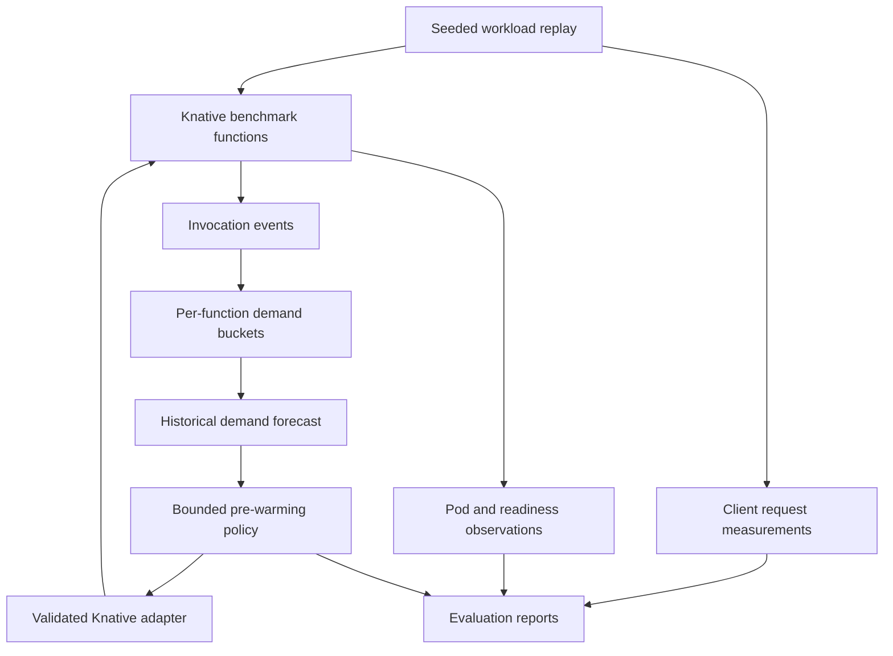

# Architecture and decisions
## Suggested implementation
Python for benchmark, collector, predictor, scheduler, and harness to minimise language and serialization differences. Standard-library HTTP benchmark is already present; choose and pin extra dependencies when required. JSONL/CSV files are sufficient for the first demo. A database, web UI, and a large message broker are optional.

## Data flow

## Phase 1 decisions
- Sample demand as counts in 30-second UTC buckets. Predict the next two buckets initially; increase horizon if measured startup latency requires it.
- Start with one warm replica per function when positive predicted demand justifies it. Evaluate demand-to-replica mapping later.
- Start with a per-function warm cap of 2 and total proactive warm budget of 6 as experiment settings. These bound proactive decisions, not all reactive replicas.
- Document separate Knative maximum scale and namespace quotas; reactive spikes can exceed a proactive budget.
- Use the same cluster, function images, concurrency settings and trace seeds for reactive, fixed-minimum, and predictive policies.
- Let Knative own its workload resources. Do not simultaneously write Deployment replicas or create competing ReplicaSets.

## Mandatory actuation spike
Minimum-scale is a documented policy setting, but a controller changing it repeatedly is not automatically a verified implementation. Updating a Service revision template may create a new revision; mutable metadata alone may not propagate into the active autoscaler's settings on the selected version.
Measure revision identity, pod readiness, route changes, retirement behavior, and scale-down behavior. Record chosen API/resource, least privileges, patch procedure, conflicts, restart behavior, and rollback in an ADR under docs/decisions/.

Possible outcomes: validated native control; explicitly scoped predictive warm-up requests; or a documented scope/design change. Do not promise successful arbitrary replica control before this gate passes.

## Forecast-to-decision
For the simple binary policy, predicted positive demand requests one warm replica subject to the budget; zero demand requests release after cooldown. For multi-replica work, derive capacity from benchmarked service time and target concurrency, rather than equating invocation count with replica count.
Use measured p95 time from decision to Ready capacity plus a safety margin as lead time. Reject stale forecasts; use reactive fallback for insufficient history or telemetry failure; retain original settings for restoration.
